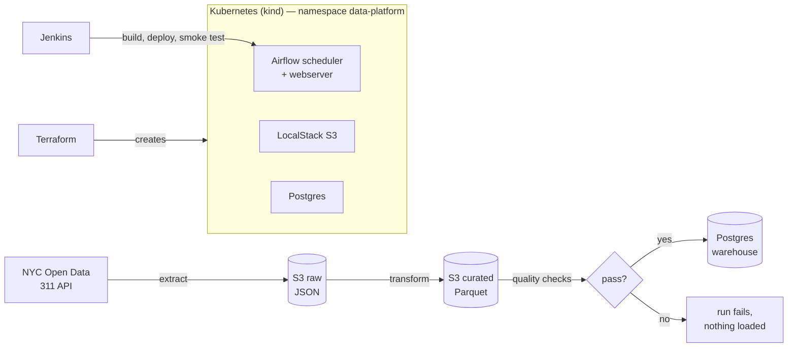

# k8s-data-platform

A small data platform that runs on a laptop: **Terraform** builds a local
**Kubernetes** cluster and an **S3** data lake (AWS emulated by LocalStack),
**Airflow** runs on Kubernetes and schedules a **Python** pipeline that pulls
NYC 311 service requests from NYC Open Data every day, checks them, and loads
them into a **Postgres** warehouse. **Jenkins** lints, tests, builds and
deploys it, and **Bash** scripts plus a runbook cover day-to-day operations.

Everything runs in Docker on your machine. No cloud account, no cost.



## What each piece does

| Layer | Tool | What it does here |
|---|---|---|
| Infrastructure | Terraform | Creates the kind cluster, namespace, LocalStack, two S3 buckets (versioning, lifecycle expiry, encryption, public access blocked) and generates every password into a Kubernetes Secret. |
| Platform | Kubernetes | Runs Postgres (StatefulSet + volume), Airflow scheduler and webserver (Deployments with health probes, resource limits, init container for DB migrations), exposed on localhost through NodePorts. |
| Orchestration | Airflow 2.10 | `nyc311_daily` DAG: extract → transform → quality checks → load, daily, with retries and backoff. |
| Pipeline | Python (pandas, boto3, psycopg2) | Pages through the Socrata API, lands raw JSON in S3, writes typed and de-duplicated Parquet, upserts into Postgres and rebuilds a daily summary table. Re-running a day never duplicates rows. |
| CI/CD | Jenkins | `Jenkinsfile`: lint Python/Terraform/manifests, unit + Postgres integration tests, build the image tagged with the commit, load it into the cluster, roll out, run the DAG end to end. Jenkins itself is configured as code (`jenkins/`). |
| Operations | Bash | `scripts/`: bring-up, deploy, smoke test, one-shot diagnostics, teardown. [`docs/RUNBOOK.md`](docs/RUNBOOK.md) covers common failures and fixes. |

## Prerequisites (macOS)

- Docker Desktop, with at least 6 GB of memory (Settings → Resources)
- `brew install kind kubectl terraform`
- Python 3.11+ (only for running the tests outside Docker)

Ports 8080 (Airflow), 4566 (S3) and 5432 (Postgres) need to be free. If one
is taken, pick another and keep it exported for every `make` run, e.g.
`export TF_VAR_airflow_host_port=8090` (all three are in `terraform/variables.tf`).

## Run it

```bash
make up          # Terraform cluster + S3, build the Airflow image, deploy (about 5–10 min the first time)
make smoke       # run the pipeline for one day and confirm rows in the warehouse
```

Then:

- Airflow UI: <http://localhost:8080>, user `admin`, password from `make airflow-password`
- Warehouse: `make psql`, then for example

  ```sql
  SELECT borough, sum(requests) AS requests
  FROM nyc311.daily_borough_summary
  GROUP BY 1 ORDER BY 2 DESC;

  SELECT * FROM nyc311.load_audit ORDER BY loaded_at DESC LIMIT 5;
  ```

- S3: `aws --endpoint-url http://localhost:4566 s3 ls s3://nyc311-raw --recursive`
  (any credentials work against LocalStack; `brew install awscli`)

```bash
make smoke DAY=2026-11-01   # load a specific day
make troubleshoot           # pod status, warning events, recent logs
make down                   # destroy everything
```

No internet? `kubectl -n data-platform set env deploy/airflow-scheduler NYC311_SOURCE=sample`
switches the extract to a bundled, clearly synthetic sample.

## CI/CD with Jenkins

```bash
make infra       # the cluster has to exist first (Jenkins joins its Docker network)
make jenkins     # Jenkins on http://localhost:8081, user admin / password admin
```

The `k8s-data-platform` job is created automatically from `jenkins/casc.yaml`
and polls `main`. Stages:

1. **Setup**: Python virtualenv with the dev requirements
2. **Lint** (parallel): ruff; `terraform fmt` + `validate`; render the kustomize manifests
3. **Tests**: unit tests plus the warehouse-load integration test against a throwaway Postgres container
4. **Connect to cluster**: internal kubeconfig from kind
5. **Build & load image**: Airflow image tagged with the short commit SHA, loaded into the kind node
6. **Deploy**: `kubectl apply` (kustomize) pinned to that tag, wait for rollouts
7. **Smoke test**: trigger the DAG for one day, wait for success, check `load_audit` in Postgres

On failure Jenkins saves `scripts/troubleshoot.sh` output as a build artifact.

## Pipeline details

- **Extract**: `GET data.cityofnewyork.us/resource/erm2-nwe9.json`, filtered to one
  day of `created_date`, ordered by `unique_key`, paged 50,000 rows at a time.
  Retries 429/5xx with exponential backoff. Optional `SOCRATA_APP_TOKEN` raises the rate limit.
- **Raw zone**: `s3://nyc311-raw/nyc311/dt=YYYY-MM-DD/service_requests.json`
  (bucket versioned, raw extracts expire after 30 days)
- **Curated zone**: `s3://nyc311-curated/nyc311/dt=YYYY-MM-DD/service_requests.parquet`
- **Transform**: typed timestamps and numbers, trimmed text, borough normalized
  (`Unspecified` → null), 5-digit ZIPs, hours-to-close (negative durations nulled),
  duplicates removed by `unique_key`.
- **Quality gate** (`pipeline/quality.py`): blocking checks for row count,
  reconciliation with distinct raw keys, unique keys, required fields, and rows
  inside the day; warnings for unknown boroughs (>10%) and close-before-open rows.
- **Load**: one transaction per day: `INSERT … ON CONFLICT DO UPDATE` into
  `nyc311.service_requests`, delete-and-rebuild of that day in
  `nyc311.daily_borough_summary`, and a row in `nyc311.load_audit`.

## Repository layout

```
terraform/   kind cluster, namespace, LocalStack, S3 buckets, secrets/config
k8s/         Postgres + Airflow manifests (kustomize)
docker/      Airflow image (DAG and pipeline baked in)
dags/        nyc311_daily DAG
pipeline/    extract, transform, quality, load (+ SQL schema)
tests/       pytest: unit, moto-mocked S3, Postgres integration
scripts/     Bash: infra-up, build-image, deploy, smoke-test, troubleshoot, down
jenkins/     Jenkins image, plugins, configuration as code, compose file
docs/        RUNBOOK.md
Jenkinsfile  CI/CD pipeline
```

## Design notes

- **Terraform owns infrastructure, Jenkins owns the application.** The cluster,
  buckets and credentials change rarely and are applied with `make infra`;
  the Airflow image and manifests change with every commit and go through Jenkins.
- **Secrets never live in the repo.** Terraform generates them (`random_password`)
  and writes a Kubernetes Secret; pods read them as environment variables.
- **Every step is re-runnable.** Each task reads its input from S3 and writes its
  output to S3 or Postgres, so a failed task retries on its own, and re-running a
  day (backfill, late-arriving 311 data) updates rows instead of duplicating them.
- **Moving to real AWS** means removing the LocalStack endpoint and test keys from
  `terraform/providers.tf` and the `S3_ENDPOINT_URL` setting; the bucket resources
  and pipeline code stay the same. The cluster would move to EKS.

## Limits

- Single-node cluster, LocalExecutor, one Postgres: built for a laptop, not for scale.
- LocalStack keeps buckets in memory; if its pod restarts, `make infra` recreates them
  (Terraform sees the drift).
- `terraform.lock.hcl` is not committed so the same code initializes on Intel and Apple Silicon.
